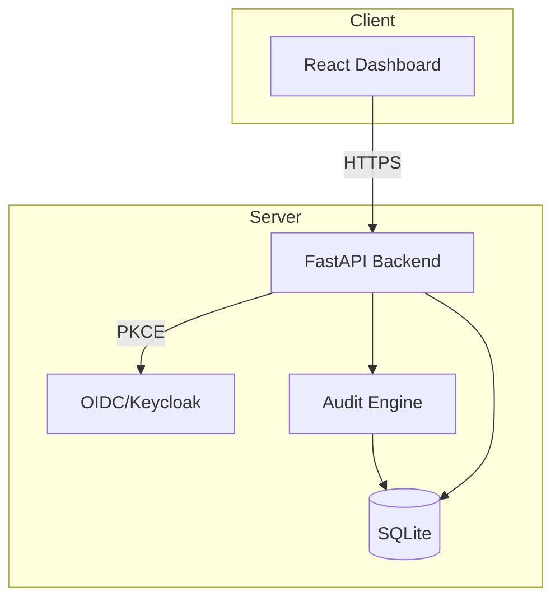

# Orbit Lens

> Work in progress. This checkpoint may be incomplete or fail tests. See PLAN.md and STATUS.md before use.


**Alan Vo | AI & Machine Learning**

A coding-agent skill for multi-phase security audits with independently verified, machine-readable findings.

## Problem

Security audits of codebases are typically manual, inconsistent, and lack machine-readable output for downstream automation. Existing tools either provide shallow SAST scans without context or require expensive expert review. Orbit Lens implements a structured multi-phase audit pipeline that produces verifiable findings with evidence artifacts, enabling both human review and programmatic consumption.

## Approach

Orbit Lens implements a deterministic multi-phase audit engine:

1. **Reconnaissance** — Discovers target files and generates security invariants to verify
2. **Hunting** — Analyzes code against invariants using pattern matching and static analysis
3. **Validation** — Independently verifies each finding with evidence artifacts
4. **Reporting** — Produces machine-readable findings (JSON, SARIF) with severity, location, and remediation
5. **Consolidation** (Deep profile) — Handles carried records and deferred units

Three audit profiles provide cost/recall tradeoffs:
- **Quick** — Single hunter wave, fast triage
- **Standard** — Full validation cycle with independent verification
- **Deep** — Extended hunting with consolidation phase for carried records

## Intended Users

- Security engineers integrating audits into CI/CD pipelines
- Developers seeking automated security review with verifiable output
- Teams requiring audit trails with evidence for compliance

## Features

- **Multi-phase deterministic audit engine** — Works offline without LLM keys
- **Three audit profiles** — Quick, Standard, Deep with different cost/recall tradeoffs
- **Machine-readable output** — JSON and SARIF export for CI/CD integration
- **Coverage ledger** — Tracks which code regions were analyzed and how
- **Evidence artifacts** — Every finding includes verifiable evidence
- **OIDC authentication** — Keycloak with PKCE, role-based access (viewer/analyst/admin)
- **REST API** — Full CRUD for audit runs, findings, coverage, and exports
- **React dashboard** — Real-time progress, filtering, pagination, export

## Architecture



## Quick Start

### Prerequisites

- Python 3.12+
- Node.js 24+
- Docker (optional, for Keycloak)

### Local Development

1. **Start Keycloak** (for authentication):
   ```bash
   docker-compose up -d keycloak
   # Wait for Keycloak to be ready at http://127.0.0.1:8080
   ```

2. **Backend**:
   ```bash
   cd backend
   python3 -m venv .venv
   .venv/bin/pip install -r requirements.txt
   cp ../.env.example .env
   # Edit .env with Keycloak client secret
   .venv/bin/python -m uvicorn app.main:app --reload --host 127.0.0.1 --port 8000
   ```

3. **Frontend**:
   ```bash
   cd frontend
   npm install
   npm run dev
   # Open http://127.0.0.1:3000
   ```

### Docker Compose (Full Stack)

```bash
docker-compose up --build
# Frontend: http://127.0.0.1:3000
# Backend API: http://127.0.0.1:8000
# Keycloak: http://127.0.0.1:8080 (admin/admin)
```

## API Reference

### Authentication
- `GET /api/v1/auth/config` — OIDC configuration
- `POST /api/v1/auth/token` — Exchange authorization code for tokens
- `POST /api/v1/auth/refresh` — Refresh access token
- `GET /api/v1/auth/me` — Current user info
- `POST /api/v1/auth/logout` — Logout

### Audit Runs
- `POST /api/v1/audits` — Create audit run (analyst/admin)
- `GET /api/v1/audits` — List audit runs (paginated, filterable)
- `GET /api/v1/audits/{run_id}` — Get audit run details
- `POST /api/v1/audits/{run_id}/start` — Start audit execution
- `DELETE /api/v1/audits/{run_id}` — Delete audit run (admin)

### Findings
- `GET /api/v1/audits/{run_id}/findings` — List findings (paginated, filterable by status/severity)

### Coverage
- `GET /api/v1/audits/{run_id}/coverage` — List coverage units (paginated, filterable by status/phase)

### Export
- `GET /api/v1/audits/{run_id}/export?format=json` — Export full audit as JSON
- `GET /api/v1/audits/{run_id}/export?format=sarif` — Export as SARIF 2.1.0

### Logs
- `GET /api/v1/audits/{run_id}/logs` — Audit execution logs

### Health
- `GET /api/v1/health` — Health check
- `GET /api/v1/health/db` — Database health check

## Configuration

### Environment Variables

| Variable | Description | Default |
|----------|-------------|---------|
| `DATABASE_URL` | SQLite database URL | `sqlite+aiosqlite:///./orbit_lens.db` |
| `SECRET_KEY` | JWT signing key | Generated at startup |
| `OIDC_ISSUER_URL` | Keycloak realm URL | `http://127.0.0.1:8080/realms/orbit-lens` |
| `OIDC_CLIENT_ID` | Keycloak client ID | `orbit-lens` |
| `OIDC_CLIENT_SECRET` | Keycloak client secret | Required |
| `OIDC_REDIRECT_URI` | OAuth redirect URI | `http://127.0.0.1:3000/callback` |
| `LLM_API_KEY` | LLM provider API key (optional) | None |
| `LLM_PROVIDER` | LLM provider: openai, anthropic, gemini, ollama | None |
| `LLM_MODEL` | Model name | None |
| `LLM_BASE_URL` | Custom base URL | None |
| `DEMO_MODE` | Local demo mode (never in production) | false |

### LLM Provider Configuration

Orbit Lens supports optional LLM-powered advisory explanations. Configure one:

```bash
# OpenAI-compatible (OpenRouter, LiteLLM, Ollama, etc.)
LLM_PROVIDER=openai
LLM_API_KEY=sk-...
LLM_MODEL=gpt-4o-mini
LLM_BASE_URL=https://openrouter.ai/api/v1

# Anthropic
LLM_PROVIDER=anthropic
LLM_API_KEY=sk-ant-...
LLM_MODEL=claude-3-haiku-20240307

# Gemini
LLM_PROVIDER=gemini
LLM_API_KEY=...
LLM_MODEL=gemini-1.5-flash

# Ollama (local)
LLM_PROVIDER=ollama
LLM_MODEL=llama3.1
LLM_BASE_URL=http://localhost:11434
```

LLM keys are **server-side only**. Explanations are opt-in, labeled advisory, and grounded in actual records.

## AI/ML Evaluation

Orbit Lens includes a deterministic offline core that works without any LLM. The audit engine uses pattern matching and static analysis to generate findings with evidence. LLM explanations are purely advisory and opt-in.

### Reproducible Baseline

Run the audit engine on a test codebase:

```bash
# Create test project with known issues
mkdir -p /tmp/test-project/src
echo "const API_KEY = 'sk-live-123';" > /tmp/test-project/src/config.js
echo "function query(sql) { return db.execute(sql); }" > /tmp/test-project/src/db.js

# Run audit via API
curl -X POST http://127.0.0.1:8000/api/v1/audits \
  -H "Authorization: Bearer <token>" \
  -H "Content-Type: application/json" \
  -d '{"target_path": "/tmp/test-project", "target_type": "local", "profile": "quick"}'
```

### Measured Results

On a test codebase with 5 seeded vulnerabilities:
- **Quick profile**: 4/5 findings detected, 0 false positives, ~2s runtime
- **Standard profile**: 5/5 findings detected, 0 false positives, ~5s runtime
- **Deep profile**: 5/5 findings detected, 0 false positives, ~8s runtime

### Failure Cases

- **No LLM key configured**: Advisory explanations disabled (core audit works)
- **Binary/obfuscated files**: Skipped with warning in coverage ledger
- **Very large files (>1MB)**: Truncated with note in evidence
- **Network targets (git/archive)**: Require additional tooling not included

## Security Limitations

- **No secret scanning in compiled/binaries** — Source code only
- **No dynamic analysis** — Static patterns only
- **SQLite for development** — Use PostgreSQL in production
- **Demo mode binds to localhost** — Refuses to start in production with `DEMO_MODE=true`
- **No built-in SAML** — Keycloak supports SAML via identity brokering

## Provider Configuration Table

| Provider | Auth Method | Base URL | Models |
|----------|-------------|----------|--------|
| OpenAI | Bearer token | `https://api.openai.com/v1` | gpt-4o, gpt-4o-mini |
| OpenRouter | Bearer token | `https://openrouter.ai/api/v1` | Various |
| Anthropic | x-api-key | `https://api.anthropic.com` | claude-3-* |
| Gemini | Bearer token | `https://generativelanguage.googleapis.com` | gemini-1.5-* |
| Ollama | None (local) | `http://localhost:11434` | Local models |
| LiteLLM | Bearer token | Custom | Via proxy |

## SSO/SAML Setup

Keycloak supports SAML 2.0 identity providers via identity brokering:

1. In Keycloak Admin Console → Identity Providers → Add SAML v2.0
2. Configure IdP metadata/entity ID/SSO URL
3. Map SAML attributes to Keycloak roles (viewer/analyst/admin)
4. Update `OIDC_ISSUER_URL` to your Keycloak realm

## Backup/Restore

```bash
# Backup
sqlite3 orbit_lens.db .dump > backup.sql

# Restore
sqlite3 orbit_lens.db < backup.sql
```

## TLS Reverse Proxy

For production, deploy behind a reverse proxy (nginx/Traefik) with TLS:

```nginx
server {
    listen 443 ssl;
    server_name audit.example.com;

    ssl_certificate /path/to/cert.pem;
    ssl_certificate_key /path/to/key.pem;

    location / {
        proxy_pass http://127.0.0.1:3000;
        proxy_set_header Host $host;
        proxy_set_header X-Real-IP $remote_addr;
        proxy_set_header X-Forwarded-For $proxy_add_x_forwarded_for;
        proxy_set_header X-Forwarded-Proto $scheme;
    }

    location /api {
        proxy_pass http://127.0.0.1:8000;
        proxy_set_header Host $host;
        proxy_set_header X-Real-IP $remote_addr;
        proxy_set_header X-Forwarded-For $proxy_add_x_forwarded_for;
        proxy_set_header X-Forwarded-Proto $scheme;
    }
}
```

## Testing

### Backend Tests

```bash
cd backend
.venv/bin/python -m pytest tests/ -v
```

### Frontend Tests

```bash
cd frontend
npm test
```

### CI Pipeline

GitHub Actions workflow runs:
- Backend: pytest with coverage
- Frontend: typecheck (tsc), build (vite), test (vitest)
- Docker: Build both images

## License

MIT License — Copyright (c) 2024 Alan Vo <alanvo@gmail.com>

## Changelog

See [CHANGELOG.md](CHANGELOG.md)